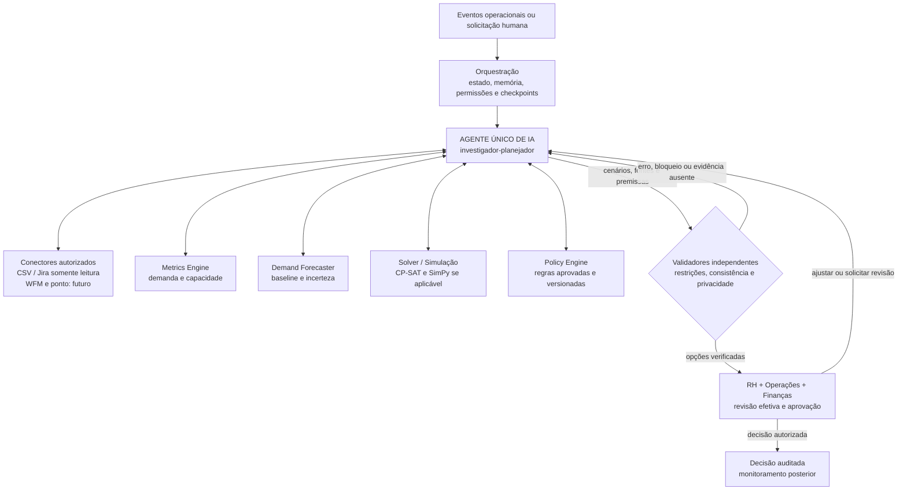

# Alinia — Workforce Intelligence

**Um agente de IA para investigar a demanda, entender a capacidade das equipes e construir alternativas de planejamento com evidências.**

A **Alinia** é uma proposta de plataforma **AI-native de Workforce Intelligence** para operações de serviços: em vez de exigir que gestores cruzem planilhas, investiguem desvios e montem cenários manualmente, **um agente investigador-planejador coordena a jornada de ponta a ponta** — recebe sinais operacionais, consulta fontes autorizadas, formula hipóteses, solicita informações, aciona modelos e ferramentas de cálculo, compara intervenções e apresenta recomendações verificáveis para decisão humana.

> **Visão do produto (PRD v4.2):** um **único agente de IA com ferramentas delimitadas**, apoiado por cálculos e verificações determinísticas independentes. **Estado desta entrega:** a base determinística e o frontend integrado já permitem uma demonstração sintética; a orquestração completa pelo agente com LLM **ainda está em desenvolvimento**. O produto não contrata pessoas nem altera escalas automaticamente.

## O problema que queremos resolver

Uma equipe pode receber mais trabalho do que consegue absorver, mas isso nem sempre significa que a solução seja contratar. A causa pode envolver um pico sazonal, backlog acumulado, competências indisponíveis em horários críticos, mudanças de processo ou capacidade distribuída incorretamente.

A análise tradicional costuma depender de indicadores fragmentados, planilhas e perguntas feitas manualmente. Isso dificulta:

- **Enxergar a demanda real:** entradas, entregas concluídas, reaberturas, cancelamentos, backlog e solicitações não atendidas são informações diferentes.
- **Encontrar a causa:** uma média semanal esconde gargalos de competência, turno e disponibilidade.
- **Comparar respostas:** contratar, trazer temporários, capacitar, realocar ou reorganizar a operação têm custo, prazo, dependências e efeitos distintos.
- **Justificar decisões:** recomendações precisam citar dados e premissas, sinalizar incertezas e respeitar regras trabalhistas e de privacidade.

**Nossa pergunta central:** *e se um agente de IA pudesse conduzir essa investigação, buscar as evidências necessárias e preparar a melhor comparação possível antes de o RH decidir?*

### Público inicial

O piloto descrito no PRD v4.2 prioriza **operações de serviços com chamados ou solicitações padronizados e histórico disponível**, como suporte técnico, serviços compartilhados, backoffice e BPO. A proposta comercial e o ganho incremental do agente ainda precisam ser validados em pilotos.

## A solução: um agente investigador-planejador

Na arquitetura final, o usuário não precisa executar manualmente cada cálculo ou escolher, por conta própria, a sequência das análises. **O agente conduz o processo** dentro de permissões, ferramentas e regras verificáveis.

| Etapa | Atuação planejada do agente de IA | Ferramentas e controles envolvidos |
| --- | --- | --- |
| **1. Receber** | Identificar uma nova demanda, aumento de backlog, alteração de capacidade ou solicitação do gestor | Eventos, CSV e Jira somente leitura; WFM e ponto em fases futuras |
| **2. Coletar e validar** | Consultar fontes autorizadas, identificar inconsistências e pedir dados que faltam | Conectores tipados, validação de esquemas, unidades, origem, versão e deduplicação |
| **3. Investigar** | Elaborar hipóteses sobre sazonalidade, competências, turnos, processos e disponibilidade; confrontá-las com evidências | Métricas, histórico, memória de execução e perguntas ao gestor |
| **4. Prever** | Escolher quando a previsão é necessária, solicitar o cálculo e interpretar a incerteza | Demand Forecaster com baseline, backtesting, intervalos e abstenção |
| **5. Planejar** | Propor intervenções adequadas ao diagnóstico e suas combinações | Cenários A–E, dados de custo, cobertura, lead time e treinamento |
| **6. Simular** | Acionar ferramentas para testar viabilidade, picos e ausência de recursos; comparar resultados | OR-Tools CP-SAT; SimPy **se houver filas** e dados adequados; Policy Engine |
| **7. Revisar e explicar** | Rever hipóteses, reconstruir cenários inválidos e apresentar trade-offs, riscos e fontes | Validadores **determinísticos independentes**, trilha de auditoria e guardrails |
| **8. Encaminhar e acompanhar** | Preparar o resultado estruturado para RH, Operações e Finanças e, após decisões autorizadas, monitorar os indicadores | Aprovação humana efetiva, rascunho de requisição, métricas pós-decisão |

O fluxo é **iterativo**, não uma sequência rígida: se uma ferramenta identificar dados insuficientes, regra conflitante ou cenário inviável, o agente volta a investigar e planejar antes de apresentar uma recomendação.

**Relato não é fato.** Respostas de gestores são registradas como relatos, com origem e data, e precisam ser confrontadas com fontes. Uma hipótese sem evidência permanece explicitamente não verificada.

### Alternativas comparadas

| Cenário | Questão investigada |
| --- | --- |
| **A · Contratar permanentemente** | Existe déficit estrutural persistente que justifique ampliar o quadro, considerando custo, recrutamento, admissão e ramp-up? |
| **B · Contratação temporária** | O problema é transitório, a modalidade é permitida e a capacidade chega a tempo? |
| **C · Realocar ou capacitar** | É possível redistribuir ou desenvolver competências sem criar um déficit na equipe de origem? |
| **D · Redesenhar turnos ou processos** | Uma reorganização melhora a cobertura e o SLA respeitando jornadas, repousos e requisitos operacionais? |
| **E · Não intervir** | O que acontece com backlog, cobertura, risco e custo se nada mudar? |

O agente **propõe e interpreta**. Os motores determinísticos calculam disponibilidade, capacidade, custo e viabilidade. Nenhuma alternativa é considerada aprovada apenas porque o modelo de linguagem a sugeriu.

## Arquitetura AI-native proposta

A decisão técnica do **PRD v4.2, seção 6**, é utilizar **um único agente** no MVP — e não cinco agentes separados. Esse agente é o **orquestrador inteligente** das ferramentas existentes; ele não substitui motores de cálculo, autorização ou validação.



### Separação de responsabilidades

| Agente de IA (LLM) | Ferramentas e serviços determinísticos |
| --- | --- |
| Planeja a investigação, formula hipóteses e escolhe quais ferramentas chamar | Calculam demanda, FTE, capacidade, custos e previsão |
| Busca contexto autorizado e solicita informações faltantes | Impõem isolamento por empresa/equipe, validação de unidades e rastreabilidade |
| Normaliza competências **com evidências** e gera alternativas A–E | Resolvem otimização de cobertura por competência e intervalo; verificam viabilidade |
| Explica incertezas, trade-offs e motivos para a recomendação | Aplicam regras jurídicas versionadas, restrições rígidas e testes independentes |
| Volta ao planejamento quando surgem bloqueios ou contradições | Persistem hashes, fontes, versões, decisões e eventos de auditoria |

**Por que ainda estamos construindo a parte determinística?** Porque ela é a fundação confiável do agente. O modelo **não pode inventar** horas disponíveis, custo, vagas, regras ou resultados do solver. Antes de incorporar autonomia de investigação, precisamos de contratos de dados, ferramentas tipadas, resultados reproduzíveis, validação e um baseline para medir se a IA realmente agrega valor.

### Memória e limites de autonomia

A arquitetura prevê memória de execução para **hipóteses, evidências, perguntas, versões e decisões**, além de memória organizacional isolada por empresa para regras e premissas aprovadas. **Dados pessoais desnecessários não devem entrar no contexto ou na memória do agente.**

O agente poderá **ler dados autorizados, investigar, calcular por ferramentas, simular, explicar e preparar rascunhos**. Ele **não** poderá selecionar ou desligar candidatos, alterar ponto, salário ou escala no MVP. A criação de requisições e qualquer ação administrativa exigem **aprovação humana explícita**, com acesso às premissas, possibilidade de alteração e justificativa registrada.

Se a previsão se abstiver, faltar uma regra ou a cobertura obrigatória falhar, o sistema deve **pedir revisão ou dados**, não oferecer uma contratação exata como fato. A revisão crítica por outro modelo pode complementar a análise, mas **não substitui os validadores determinísticos**.

## O que estamos entregando agora

O trabalho foi dividido em duas camadas: **a base de decisão verificável, que já está em desenvolvimento funcional**, e **a experiência agentic completa, que é o objetivo do produto**.

| Componente | Estado nesta branch |
| --- | --- |
| Novo frontend com Visão geral, Investigação, Previsão, Cenários e Revisão do RH | **Implementado e conectado à API** |
| Autenticação, escopo por empresa/equipe, snapshots, métricas e auditoria | **Implementado para demonstração** |
| CSV e fixture de Jira com dados sintéticos | **Implementado**; coleta ativa pelo agente e Jira real ainda pendentes |
| Investigação com checkpoints, perguntas e retomada | **Implementada de forma determinística**; não é ainda a orquestração autônoma do LLM |
| Previsão com mediana móvel, backtesting e abstenção | **Baseline implementado**; faltam previsões aplicadas por skill e turno |
| Cenários A–E | **Estruturados na API**; B/C/D ainda não são simulações quantitativas completas |
| CP-SAT v4.2 e validador independente | **Módulos existentes e testados**, ainda não conectados ao workflow principal |
| **Agente único de IA orquestrando coleta → investigação → planejamento → simulação** | **Visão final, ainda não integrada neste fluxo** |
| Sincronização operacional com Jira real | **Pendente** |
| Aprovação definitiva e requisição operacional | **Bloqueadas** até validação independente e revisão autorizada |

Há também uma **experimentação separada do agente** na branch [`agent/alinia-investigator`](https://github.com/Arturvpf/MangueByte-Converge-challenge/tree/agent/alinia-investigator), com ferramentas de leitura, recuperação de regras e filtros de privacidade. **Não está integrada a esta branch** e não comprova ainda o fluxo AI-native de ponta a ponta.

### Como comprovaremos o valor da IA

O PRD v4.2 propõe um experimento com **três abordagens sobre os mesmos dados e decisões**:

1. **Processo atual:** a forma como a empresa dimensiona suas equipes hoje.
2. **Baseline determinístico:** métricas, forecast e cenários com fluxo convencional, **sem LLM**.
3. **Alinia AI-native:** o baseline **mais o agente investigador-planejador** que coordena a coleta, formula hipóteses, chama ferramentas, revisa alternativas e explica a decisão.

O objetivo não é medir quantas chamadas ao LLM foram feitas, mas se o agente **reduz tempo e retrabalho, melhora a fundamentação e evita erros**, sem aumentar riscos. Os indicadores incluem tempo até decisão validada, SLA, backlog, custo total, qualidade da previsão, cobertura por turno, contestações e intervenções humanas. **Se o agente não demonstrar ganho incremental, a decisão prevista no PRD é manter a solução sem LLM.**

## Tecnologias

| Camada | Tecnologias |
| --- | --- |
| Frontend | HTML, CSS, JavaScript ES Modules e gráficos SVG |
| API e contratos | Python 3.12, FastAPI, Pydantic |
| Dados e auditoria | SQLAlchemy, Alembic, SQLite local e PostgreSQL |
| Ferramentas de planejamento | Metrics Engine, Demand Forecaster, OR-Tools CP-SAT v4.2 isolado |
| Orquestração de IA | **LangGraph como direção técnica do projeto**; fluxo produtivo do agente ainda não integrado |
| Qualidade | Pytest, regressões de frontend/API, GitHub Actions |

---

## Como executar

### Pré-requisitos

**Git** e **Python 3.12** são suficientes para iniciar a plataforma completa com SQLite. **Node.js 22** é necessário somente para executar ou gerar o build do site estático. Todos os comandos a seguir partem da **raiz do repositório**.

### 1. Obter a versão da entrega

```bash
git clone https://github.com/Arturvpf/MangueByte-Converge-challenge.git
cd MangueByte-Converge-challenge
git switch fix/auditoria-v42-p1-p2-2026-11-08
```

Esta versão está no [PR de integração e correções #2](https://github.com/Arturvpf/MangueByte-Converge-challenge/pull/2), ainda separado da `main`.

### 2. Instalar o backend

**Windows — PowerShell**

```powershell
py -3.12 -m venv backend/.venv
.\backend\.venv\Scripts\Activate.ps1
python -m pip install -r backend/requirements.lock.txt
```

**Linux/macOS**

```bash
python3.12 -m venv backend/.venv
source backend/.venv/bin/activate
python -m pip install -r backend/requirements.lock.txt
```

### 3. Configurar autenticação e banco local

O SQLite já é o banco padrão (`sqlite:///./alinia.db`). Defina a chave de autenticação **no mesmo terminal** que executará o backend.

**PowerShell**

```powershell
$env:DATABASE_URL = "sqlite:///./alinia.db"
$env:ALINIA_AUTH_SECRET = python -c "import secrets; print(secrets.token_urlsafe(48))"
```

**Linux/macOS**

```bash
export DATABASE_URL="sqlite:///./alinia.db"
export ALINIA_AUTH_SECRET="$(python -c 'import secrets; print(secrets.token_urlsafe(48))')"
```

O arquivo [`backend/.env.example`](backend/.env.example) descreve as demais variáveis, **mas não é carregado automaticamente**. Não versionar tokens, senhas ou segredos. Para preservar sessões entre reinicializações, reutilize a mesma chave de autenticação.

### 4. Preparar o banco e criar o usuário de demonstração

```bash
python -m alembic -c backend/alembic.ini upgrade head
python -m backend.app.auth.cli create-tenant --tenant-id demo --name "Empresa Demo"
python -m backend.app.auth.cli create-user --tenant-id demo --email rh@demo.example --role rh
```

A criação do usuário solicita uma senha no terminal. O perfil **RH** pode investigar e registrar decisões; o perfil `admin` é destinado à administração de contas e não substitui o RH na demonstração.

Os comandos de criação só precisam ser executados **uma vez em um banco novo**.

### 5. Iniciar a aplicação integrada

```bash
python -m uvicorn backend.app.main:create_app --factory --reload
```

| Endereço local | Finalidade |
| --- | --- |
| [`/prototype/`](http://127.0.0.1:8000/prototype/) | Landing page |
| [`/prototype/app/`](http://127.0.0.1:8000/prototype/app/) | **Plataforma integrada ao backend** |
| [`/docs`](http://127.0.0.1:8000/docs) | Swagger/OpenAPI |
| [`/health`](http://127.0.0.1:8000/health) | Verificação básica do processo |

Todos usam `http://127.0.0.1:8000`. O FastAPI serve os arquivos do frontend e as APIs **na mesma origem**. A aplicação não exige um servidor Node separado para autenticar e consultar dados.

### 6. Carregar dados sintéticos para a demonstração

A plataforma lista snapshots existentes, mas **a importação de CSV ainda não está implementada na interface**. O caminho mais curto para preparar uma demonstração é a fixture de Jira, **sem conexão com Jira real**:

1. Abra [`http://127.0.0.1:8000/docs`](http://127.0.0.1:8000/docs) e execute `POST /api/auth/login` usando `tenant_id: demo`, `email: rh@demo.example` e sua senha.
2. Copie o `access_token` e configure-o no botão **Authorize** do Swagger.
3. Execute `POST /api/imports/jira` com o JSON abaixo. A resposta `status: complete` indica que o snapshot sintético foi persistido.
4. Abra [a plataforma](http://127.0.0.1:8000/prototype/app/), entre com as mesmas credenciais, selecione a equipe `team-demo` e carregue as métricas.

```json
{
  "team_id": "team-demo",
  "fixture": "issues"
}
```

**Alternativa:** usar `POST /api/imports` com um CSV agregado (como texto no campo JSON `content`) e depois `POST /api/imports/{import_id}/confirm`. O formato e os campos obrigatórios estão descritos em [`backend/CONTRATOS.md`](backend/CONTRATOS.md) e em `backend/app/ingestion/csvparse.py`. Nenhum dado pessoal deve ser usado na demonstração.

### 7. Percorrer o fluxo no frontend

Com o snapshot carregado, a demonstração sugerida é: **Visão geral → Abrir investigação → Responder às perguntas → Previsão → Comparar A–E → Revisão do RH**.

**Nesta entrega, a execução demonstrada é determinística**: a investigação pode exigir mais de uma rodada de respostas, mas o agente LLM ainda não escolhe nem executa as ferramentas do fluxo principal. Relatos do gestor continuam **não verificados** e não alteram automaticamente a capacidade calculada. Com histórico insuficiente, a previsão se abstém e os cenários ficam inconclusivos. O bloqueio de aprovação é **comportamento esperado**, não falha de instalação.

## Testes e build

**Backend e migrações** (ambiente Python ativo):

```bash
python -m pytest backend/tests -q
python -m alembic -c backend/alembic.ini upgrade head
```

**Frontend estático** (Node.js 22):

```bash
node --check src/app/app.js
npm run build
npm run dev
```

`npm run dev` serve apenas os arquivos estáticos em `http://127.0.0.1:5173`. **Para testar a integração com as rotas `/api`, use a plataforma via FastAPI na porta `8000`**, como mostrado acima.

O CI executa testes de backend, regressões da integração HTTP/DOM, verificação de JavaScript, build e migração PostgreSQL a partir de um esquema legado. Veja o [workflow de integração](.github/workflows/p1-p2-integration.yml).

## Próximos passos para a experiência AI-native

A evolução do produto deve integrar o **agente único** ao workflow já persistido: consultar fontes autorizadas; gerar e revisar hipóteses; solicitar dados ausentes; chamar previsão e CP-SAT por ferramentas tipadas; comparar alternativas A–E; submeter os resultados a validadores independentes e só então encaminhar uma proposta verificável à revisão humana.

Antes de um piloto empresarial, ainda são necessários: sincronização Jira real somente leitura, simulações quantitativas A–D, previsão por skill/turno, validação de política por categoria/contrato, proteção de dados e testes de segurança do agente (inclusive prompt injection e saídas de ferramentas), avaliações de viés e experimento de ganho incremental do LLM.

**A intenção é tornar o agente o centro da experiência de investigação, sem transformar o LLM em fonte de verdade matemática, jurídica ou decisória.**

## Organização do repositório

```text
src/                      Landing page e aplicação web
scripts/                  Servidor estático e build do frontend
backend/app/              API e módulos de domínio
backend/migrations/       Evolução de esquema com Alembic
backend/fixtures/         Entradas sintéticas para demonstração
backend/tests/            Testes unitários e de integração
docs/                     PRD, auditoria e decisões técnicas
.github/workflows/        Validações automatizadas
```

### Documentação técnica

- [Integração entre frontend e backend](docs/INTEGRACAO_FRONTEND_BACKEND.md)
- [Correções e pendências da auditoria v4.2](docs/CORRECOES_AUDITORIA_V42.md)
- [Matriz de aceite do PRD v4.2](docs/REBASELINE_PRD_V42.md)
- [Backend: autenticação, políticas, contratos e limitações](backend/README.md)
- [Metodologia da landing](docs/ABORDAGEM.md)

---

**Alinia — um agente para investigar, reunir evidências e construir alternativas; pessoas continuam responsáveis pelas decisões.**

*A versão atual demonstra a fundação determinística com dados sintéticos. A visão AI-native descrita acima corresponde à arquitetura pretendida no PRD v4.2, não a funcionalidades já finalizadas nesta branch.*