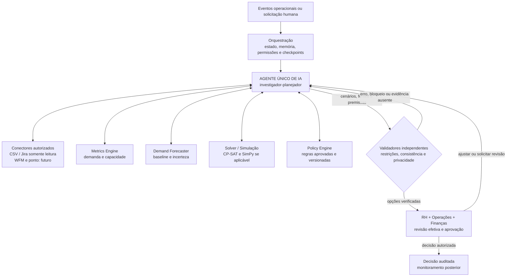

# Alinia — Workforce Intelligence

**Um agente de IA para investigar a demanda, entender a capacidade das equipes e construir alternativas de planejamento com evidências.**

A **Alinia** é uma plataforma experimental **AI-native de Workforce Intelligence** para operações de serviços. Ela une uma **conversa em linguagem natural**, ferramentas de investigação conectadas a uma API de dados operacionais e uma base determinística para métricas, previsão e cenários. A visão do produto é que um agente investigador-planejador coordene, de ponta a ponta, a coleta, as análises e a preparação de alternativas — sempre com evidências e decisão humana.

> **O que já existe na `main`:** uma interface de conversa com a Alinia, um serviço de agente separado com **DeepSeek via Featherless** para o caso sintético da equipe Centro, ferramentas de leitura da API, um workflow de investigação determinístico e cinco categorias de cenários. **O LLM ainda não orquestra automaticamente o fluxo completo nem gera decisões de contratação.**

## O problema que queremos resolver

Uma equipe pode receber mais trabalho do que consegue absorver, mas isso nem sempre significa que a solução seja contratar. A causa pode envolver um pico sazonal, backlog acumulado, competências indisponíveis em horários críticos, mudanças de processo ou capacidade distribuída incorretamente.

A análise tradicional costuma depender de indicadores fragmentados, planilhas e perguntas feitas manualmente. Isso dificulta:

- **Enxergar a demanda real:** entradas, entregas concluídas, reaberturas, cancelamentos, backlog e solicitações não atendidas são informações diferentes.
- **Encontrar a causa:** uma média semanal esconde gargalos de competência, turno e disponibilidade.
- **Comparar respostas:** contratar, trazer temporários, capacitar, realocar ou reorganizar a operação têm custo, prazo, dependências e efeitos distintos.
- **Justificar decisões:** recomendações precisam citar dados e premissas, sinalizar incertezas e respeitar regras trabalhistas e de privacidade.

**Nossa pergunta central:** *e se um agente de IA pudesse conduzir essa investigação, buscar as evidências necessárias e preparar a melhor comparação possível antes de o RH decidir?*

### Público inicial

A Alinia foi concebida inicialmente para **operações de serviços que trabalham com solicitações recorrentes, indicadores de atendimento e histórico disponível** — como suporte técnico, serviços compartilhados, backoffice e BPO. Nesse contexto, é possível comparar volume recebido, trabalho concluído, backlog, cobertura de turnos e qualidade. A aderência e o retorno financeiro ainda precisam ser comprovados com empresas parceiras.

## A solução: um agente investigador-planejador

Na experiência pretendida, o usuário não precisa definir manualmente a ordem de cada análise. **O agente deverá conduzir a investigação**, acionando ferramentas autorizadas, enquanto os motores quantitativos e as validações permanecem responsáveis pelos resultados verificáveis. A versão atual já demonstra partes desse processo, mas ainda não oferece orquestração integral pelo LLM.

| Etapa | Atuação planejada do agente de IA | Ferramentas e controles envolvidos |
| --- | --- | --- |
| **1. Receber** | Identificar uma nova demanda, aumento de backlog, alteração de capacidade ou solicitação do gestor | Eventos, CSV e Jira somente leitura; WFM e ponto em fases futuras |
| **2. Coletar e validar** | Consultar fontes autorizadas, identificar inconsistências e pedir dados que faltam | Conectores tipados, validação de esquemas, unidades, origem, versão e deduplicação |
| **3. Investigar** | Elaborar hipóteses sobre sazonalidade, competências, turnos, processos e disponibilidade; confrontá-las com evidências | Métricas, histórico, memória de execução e perguntas ao gestor |
| **4. Prever** | Escolher quando a previsão é necessária, solicitar o cálculo e interpretar a incerteza | Demand Forecaster com baseline, backtesting, intervalos e abstenção |
| **5. Planejar** | Propor intervenções adequadas ao diagnóstico e suas combinações | Cenários A–E, dados de custo, cobertura, lead time e treinamento |
| **6. Simular** | Acionar ferramentas para testar viabilidade, picos e ausência de recursos; comparar resultados | OR-Tools CP-SAT; SimPy **se houver filas** e dados adequados; Policy Engine |
| **7. Revisar e explicar** | Rever hipóteses, reconstruir cenários inválidos e apresentar trade-offs, riscos e fontes | Validadores **determinísticos independentes**, trilha de auditoria e guardrails |
| **8. Encaminhar e acompanhar** | Preparar o resultado estruturado para RH, Operações e Finanças e, após decisões autorizadas, monitorar os indicadores | Aprovação humana efetiva, rascunho de requisição, métricas pós-decisão |

O fluxo é **iterativo**, não uma sequência rígida: se uma ferramenta identificar dados insuficientes, regra conflitante ou cenário inviável, o agente volta a investigar e planejar antes de apresentar uma recomendação.

**Relato não é fato.** Respostas de gestores são registradas como relatos, com origem e data, e precisam ser confrontadas com fontes. Uma hipótese sem evidência permanece explicitamente não verificada.

### Alternativas comparadas

| Cenário | Questão investigada |
| --- | --- |
| **A · Contratar permanentemente** | Existe déficit estrutural persistente que justifique ampliar o quadro, considerando custo, recrutamento, admissão e ramp-up? |
| **B · Contratação temporária** | O problema é transitório, a modalidade é permitida e a capacidade chega a tempo? |
| **C · Realocar ou capacitar** | É possível redistribuir ou desenvolver competências sem criar um déficit na equipe de origem? |
| **D · Redesenhar turnos ou processos** | Uma reorganização melhora a cobertura e o SLA respeitando jornadas, repousos e requisitos operacionais? |
| **E · Não intervir** | O que acontece com backlog, cobertura, risco e custo se nada mudar? |

O agente **propõe e interpreta**. Os motores determinísticos calculam disponibilidade, capacidade, custo e viabilidade. Nenhuma alternativa é considerada aprovada apenas porque o modelo de linguagem a sugeriu.

## Arquitetura: IA para investigar, ferramentas para validar

**A arquitetura-alvo utiliza um único agente investigador-planejador.** Ele deverá decidir quais informações buscar, quando aprofundar hipóteses e quais análises solicitar, sem substituir motores de cálculo, permissões ou validadores. **Na implementação atual**, o chat demonstra respostas com LLM sobre um caso sintético e usa roteamento por intenções e ferramentas fixas para consultas à API; essa separação ainda não representa a orquestração autônoma descrita no diagrama.



### Separação de responsabilidades

| Agente de IA (LLM) | Ferramentas e serviços determinísticos |
| --- | --- |
| Planeja a investigação, formula hipóteses e escolhe quais ferramentas chamar | Calculam demanda, FTE, capacidade, custos e previsão |
| Busca contexto autorizado e solicita informações faltantes | Impõem isolamento por empresa/equipe, validação de unidades e rastreabilidade |
| Normaliza competências **com evidências** e gera alternativas A–E | Resolvem otimização de cobertura por competência e intervalo; verificam viabilidade |
| Explica incertezas, trade-offs e motivos para a recomendação | Aplicam regras jurídicas versionadas, restrições rígidas e testes independentes |
| Volta ao planejamento quando surgem bloqueios ou contradições | Persistem hashes, fontes, versões, decisões e eventos de auditoria |

**Por que combinar IA e métodos determinísticos?** O agente é útil para explorar causas, buscar contexto e organizar possibilidades. Já os cálculos de horas, custos, requisitos, elegibilidade e cobertura devem ser reprodutíveis. Por isso, a Alinia utiliza contratos de dados, ferramentas tipadas, regras versionadas e validação independente para impedir que uma resposta convincente seja confundida com uma recomendação comprovada.

### Memória e limites de autonomia

A arquitetura prevê memória de execução para **hipóteses, evidências, perguntas, versões e decisões**, além de memória organizacional isolada por empresa para regras e premissas aprovadas. **Dados pessoais desnecessários não devem entrar no contexto ou na memória do agente.**

O agente poderá **ler dados autorizados, investigar, calcular por ferramentas, simular, explicar e preparar rascunhos**. Ele **não** poderá selecionar ou desligar candidatos, alterar ponto, salário ou escala no MVP. A criação de requisições e qualquer ação administrativa exigem **aprovação humana explícita**, com acesso às premissas, possibilidade de alteração e justificativa registrada.

Se a previsão se abstiver, faltar uma regra ou a cobertura obrigatória falhar, o sistema deve **pedir revisão ou dados**, não oferecer uma contratação exata como fato. A revisão crítica por outro modelo pode complementar a análise, mas **não substitui os validadores determinísticos**.

## O que já pode ser demonstrado

A plataforma oferece duas experiências, identificadas na interface:

| Modo | Como funciona hoje | Limite |
| --- | --- | --- |
| **Conversa sintética com a Alinia** | A tela inicial usa o caso fictício **Unidade Centro**. Com o servidor do agente ativo, perguntas sobre situação, previsão e questões livres podem ser respondidas pelo **DeepSeek via Featherless**, utilizando fatos sintéticos e histórico gerado de **60 meses**. | O LLM consulta um caso sintético fixo; não decide contratações nem executa CP-SAT a partir do chat. Sem agente ou credencial, existe resposta demonstrativa local. |
| **Investigação conectada ao backend** | Após autenticação, a interface usa ferramentas com encaminhamento por intenção para consultar **snapshots, métricas, ledger de demanda, investigações, forecast, políticas e cenários** da API FastAPI. Exibe etapas e origem dos dados; pode registrar respostas do gestor como relatos. | A seleção das ferramentas é **determinística**, não feita pelo LLM. O serviço DeepSeek demonstrativo não lê automaticamente a equipe autenticada. |

A aplicação web inclui **Conversa com a Alinia**, **Visão geral**, **Investigação**, **Previsão**, **Cenários** e **Revisão do RH**. A landing apresenta o problema e a proposta.

| Componente | Situação |
| --- | --- |
| Interface de chat e roteamento de intenções | **Implementados** em `src/app/agent.js` |
| Proxy `/agent/chat` e `/agent/health` no servidor Node de desenvolvimento | **Implementado** em `scripts/serve.mjs`; não existe no servidor FastAPI |
| Serviço do agente, canal HTTP e streaming de respostas | **Implementados** em `alinia-investigator/` |
| Modelo DeepSeek via Featherless | **Integrado ao chat sintético**, condicionado a chave de API e disponibilidade do provedor |
| Histórico sintético Centro (60 meses), resumo de capacidade e filtros de privacidade | **Disponíveis** no projeto do agente |
| Autenticação, controle de acesso, importação CSV, fixture Jira, snapshots e métricas | **Implementados** no backend |
| Workflow de investigação com perguntas, checkpoints, revisão e retomada | **Implementado de forma determinística** |
| Forecast por competência e turno | P10/P50/P90 condicionados a backtest temporal e cobertura observada |
| Planejamento A–E | CP-SAT e verificação independente no workflow exploratório |
| Coleta Jira e filas | Coleta somente leitura com checkpoint e SimPy quando há parâmetros suficientes |
| Revisão e resultados | Replanejamento versionado pelo RH e comparação semanal com observações agregadas |

**Segurança:** o agente de demonstração não aprova, rejeita nem adia decisões no lugar do RH. A API preserva controle de acesso, verificação de versão e bloqueios para aprovação de cenários sem evidência independente. Dados de exemplo não são medições de uma empresa real.

**Observação:** o diretório [`alinia-investigator/`](alinia-investigator/) **já está na `main`**. Não é necessário mudar para outra branch para executá-lo. Os resultados da IA e do workflow continuam sendo componentes distintos que ainda precisam de integração operacional completa.

### Como vamos medir o valor da IA

Para avaliar o ganho real do agente, planejamos comparar **três formas de tomar a mesma decisão, usando os mesmos dados**:

1. **Processo atual:** a forma como a empresa dimensiona suas equipes hoje.
2. **Baseline determinístico:** métricas, forecast e cenários com fluxo convencional, **sem LLM**.
3. **Alinia AI-native:** o baseline **mais o agente investigador-planejador** que coordena a coleta, formula hipóteses, chama ferramentas, revisa alternativas e explica a decisão.

O objetivo não é medir o número de chamadas ao modelo, mas se a investigação assistida por IA **reduz o tempo até uma decisão fundamentada, diminui retrabalho e evita erros**, sem aumentar riscos. Avaliaremos tempo de análise, SLA, backlog, custos, qualidade das previsões, cobertura por turno, contestações e intervenções humanas. **O componente de IA precisa demonstrar benefício adicional em relação à análise determinística, não apenas produzir respostas mais elaboradas.**

### Exemplo de investigação conduzida pelo agente

Imagine que uma equipe de suporte apresente aumento de backlog por três semanas. Em vez de recomendar imediatamente novas contratações, **o agente deverá** consultar o histórico de entradas e conclusões, verificar a distribuição por competência e turno e investigar explicações alternativas, como sazonalidade, indisponibilidade temporária ou mudança de processo. Se faltarem dados essenciais, ele solicita a informação ao gestor ou sinaliza a limitação.

Com evidências suficientes, o agente aciona ferramentas para projetar demanda e comparar contratação permanente, temporários, realocação, redesenho operacional e nenhuma intervenção. Cada alternativa precisa mostrar **prazo de efeito, cobertura, custo estimado, riscos, premissas e pontos que exigem revisão**. Um cenário inviável volta para investigação; o resultado só segue ao RH depois de passar pelas validações aplicáveis.

*Esse exemplo ilustra a experiência pretendida com IA. A versão atual permite demonstrar as etapas de dados, investigação determinística e comparação exploratória, mas não toda a autonomia descrita acima.*

## Tecnologias

| Camada | Tecnologias |
| --- | --- |
| Frontend | HTML, CSS, JavaScript ES Modules e gráficos SVG |
| API e contratos | Python 3.12, FastAPI, Pydantic |
| Dados e auditoria | SQLAlchemy, Alembic, SQLite local e PostgreSQL |
| Ferramentas de planejamento | Métricas, forecast semanal, OR-Tools CP-SAT, SimPy e validação independente |
| Serviço do agente | **TypeScript, Agent SDK, DeepSeek/Featherless, LangChain** para recuperação de regras e dados sintéticos |
| Orquestração e workflow | Workflow Python persistido; agente TypeScript separado, com ferramentas de leitura; LangGraph experimental no backend | 
| Qualidade | Pytest, testes do agente (`npm test`), verificação TypeScript, CI de backend/frontend |

---

## Como executar

### Pré-requisitos

Para o **backend e o painel conectado**, use **Git e Python 3.12**. Para o **chat com o modelo DeepSeek e o proxy local**, utilize também **Node.js 22+ e npm**. A conexão ao provedor de LLM depende de uma chave Featherless; a demonstração sintética oferece respostas locais de contingência quando ela não estiver disponível. Os comandos abaixo partem da **raiz do repositório**, salvo quando indicado.

### 1. Clonar o projeto

```bash
git clone https://github.com/Arturvpf/MangueByte-Converge-challenge.git
cd MangueByte-Converge-challenge
```

A branch padrão é a **`main`**, que contém a aplicação integrada e as instruções desta entrega.

### 2. Instalar o backend

**Windows — PowerShell**

```powershell
py -3.12 -m venv backend/.venv
.\backend\.venv\Scripts\Activate.ps1
python -m pip install -r backend/requirements.lock.txt
```

**Linux/macOS**

```bash
python3.12 -m venv backend/.venv
source backend/.venv/bin/activate
python -m pip install -r backend/requirements.lock.txt
```

### 3. Configurar autenticação e banco local

O SQLite já é o banco padrão (`sqlite:///./alinia.db`). Defina a chave de autenticação **no mesmo terminal** que executará o backend.

**PowerShell**

```powershell
$env:DATABASE_URL = "sqlite:///./alinia.db"
$env:ALINIA_AUTH_SECRET = python -c "import secrets; print(secrets.token_urlsafe(48))"
```

**Linux/macOS**

```bash
export DATABASE_URL="sqlite:///./alinia.db"
export ALINIA_AUTH_SECRET="$(python -c 'import secrets; print(secrets.token_urlsafe(48))')"
```

O arquivo [`backend/.env.example`](backend/.env.example) descreve as demais variáveis, **mas não é carregado automaticamente**. Não versionar tokens, senhas ou segredos. Para preservar sessões entre reinicializações, reutilize a mesma chave de autenticação.

### 4. Preparar o banco e criar o usuário de demonstração

```bash
python -m alembic -c backend/alembic.ini upgrade head
python -m backend.app.auth.cli create-tenant --tenant-id demo --name "Empresa Demo"
python -m backend.app.auth.cli create-user --tenant-id demo --email rh@demo.example --role rh
```

A criação do usuário solicita uma senha no terminal. O perfil **RH** pode investigar e registrar decisões; o perfil `admin` é destinado à administração de contas e não substitui o RH na demonstração.

Os comandos de criação só precisam ser executados **uma vez em um banco novo**.

### 5. Iniciar o backend e acessar as análises

```bash
python -m uvicorn backend.app.main:create_app --factory --reload
```

| Endereço local | Finalidade |
| --- | --- |
| [`/prototype/`](http://127.0.0.1:8000/prototype/) | Landing page |
| [`/prototype/app/`](http://127.0.0.1:8000/prototype/app/) | **Plataforma integrada ao backend** |
| [`/docs`](http://127.0.0.1:8000/docs) | Swagger/OpenAPI |
| [`/health`](http://127.0.0.1:8000/health) | Verificação básica do processo |

Todos usam `http://127.0.0.1:8000`. O FastAPI serve o frontend e as rotas **`/api`** na mesma origem. **Esse modo não fornece o proxy `/agent/*` para o DeepSeek**: a conversa da equipe autenticada usa as ferramentas determinísticas locais. O chat LLM do exemplo Centro é executado pelo modo Node da etapa 5.1.

### 5.1. Executar a conversa com DeepSeek (caso sintético Centro)

A `main` já contém o serviço `alinia-investigator/`, a tela `src/app/agent.js` e o proxy local. Esse modo demonstra respostas em linguagem natural sobre a **equipe Centro sintética**; não usa os snapshots da sua sessão FastAPI.

Em um **segundo terminal**, instale as dependências do agente:

```bash
cd alinia-investigator
npm ci
npm run index
cd ..
```

Configure `FEATHERLESS_API_KEY` no **ambiente do processo** que iniciará o agente (consulte [`alinia-investigator/.env.example`](alinia-investigator/.env.example)). Nunca coloque essa chave no JavaScript do frontend ou no Git. `FEATHERLESS_MODEL` é opcional e possui um valor padrão no código. Se não houver credencial, o serviço responde com fatos locais do caso sintético, **sem geração de texto pelo modelo**.

No **segundo terminal**, a partir da raiz:

```bash
npm run agent
```

Em um **terceiro terminal**, também na raiz:

```bash
npm run dev
```

Abra **http://127.0.0.1:5173/app/**. Nesse modo, o frontend envia `POST /agent/chat` ao servidor Node, que encaminha ao serviço do agente em `http://127.0.0.1:3141` (ou `ALINIA_AGENT_URL`).

**Diferença importante entre as portas:**

| URL | Funcionalidade |
| --- | --- |
| `http://127.0.0.1:5173/app/` | Demonstra o **chat LLM sintético** via proxy `/agent/*`; não possui proxy para as APIs FastAPI `/api` |
| `http://127.0.0.1:8000/prototype/app/` | Demonstra o **painel autenticado e as investigações reais do backend**; não possui proxy `/agent/*` |

Para perguntas sobre **seus próprios snapshots**, utilize a porta **8000**; para experimentar o **modelo DeepSeek com o caso sintético Centro**, utilize a porta **5173** com os dois processos Node ligados. **Essas duas experiências ainda não estão reunidas em uma única origem HTTP.**

### 6. Carregar dados sintéticos para a demonstração

Abra [a plataforma local](http://127.0.0.1:8000/prototype/app/), entre com o perfil RH em **Conectar dados** e use **Carregar dados sintéticos → Carregar demonstração → Abrir investigação**. O perfil padrão `gargalo` carrega 88 semanas, três competências, dois turnos e pools compartilhados. Também estão disponíveis os perfis `pico`, `estrutural` e `turnos`.

```bash
python -m backend.app.ingestion.demo --profile gargalo --output alinia-demo.csv
```

Em **Previsão**, escolha uma competência ou turno. Em **Cenários**, compare A–E e abra a matriz semanal. Em **Revisão do RH**, é possível recalcular com outra evidência, adiar ou rejeitar uma alternativa e acompanhar resultados agregados. A aprovação exige validação de jornada, cobertura, habilitação e orçamento.

O [guia de planejamento quantitativo](docs/PLANEJAMENTO_QUANTITATIVO.md) documenta os resultados do caso de gargalo, as hipóteses, os endpoints de replanejamento e observação, a coleta Jira e a ferramenta do Investigador.

## Testes e build

**Backend e migrações** (ambiente Python ativo):

```bash
python -m pytest backend/tests -q
python -m alembic -c backend/alembic.ini upgrade head
```

**Frontend estático e agente** (Node.js 22+):

```bash
node --check src/app/app.js
node --check src/app/agent.js
npm run build
cd alinia-investigator
npm ci
npm run check
npm test
cd ..
npm run dev
```

`npm run dev` serve os arquivos estáticos e repassa apenas **`/agent/*`** para o agente na porta 3141. Não repassa **`/api/*`** ao FastAPI. Para investigar um snapshot autenticado, use **`/prototype/app/` na porta 8000**.

O workflow atual de CI cobre backend, contratos, migrações, sintaxe do `src/app/app.js` e build da página. Os testes TypeScript do agente podem ser executados separadamente com `npm run check` e `npm test`; não assuma que o CI atual os valida automaticamente. Veja o [workflow de integração](.github/workflows/p1-p2-integration.yml).

## Evolução da plataforma

Já existe um chat de exemplo que consulta fatos sintéticos e pode gerar respostas com DeepSeek. O próximo marco é **ligar esse agente às investigações autenticadas do backend**, com um contexto por equipe e execução, ferramentas tipadas para previsão e otimização, seleção de ferramentas pelo próprio agente e guardrails persistidos. O modelo deverá investigar, pedir esclarecimentos e apresentar alternativas com evidências; validadores independentes continuarão determinando quais propostas podem avançar.

Antes de um piloto empresarial, ainda são necessários: sincronização Jira real somente leitura, simulações quantitativas A–D, previsão por skill/turno, validação de política por categoria/contrato, proteção de dados e testes de segurança do agente (inclusive prompt injection e saídas de ferramentas), avaliações de viés e experimento de ganho incremental do LLM.

Os resultados ilustrativos não são indicadores operacionais reais. Antes de carregar um recorte, o frontend exibe séries de exemplo. Depois, o gráfico da visão geral usa a demanda importada (`demand-flow`), com a capacidade do último período como referência constante; as métricas carregadas da API são identificadas separadamente.

**A intenção é tornar o agente o centro da experiência de investigação, sem transformar o LLM em fonte de verdade matemática, jurídica ou decisória.**

## Organização do repositório

```text
src/                      Landing page, painel e conversa com a Alinia
alinia-investigator/      Agente TypeScript, canal HTTP, LLM, regras e dados sintéticos
scripts/                  Servidor estático, proxy do agente e build
backend/app/              API e módulos de domínio
backend/migrations/       Evolução de esquema com Alembic
backend/fixtures/         Entradas sintéticas para demonstração
backend/tests/            Testes unitários e de integração
docs/                     Arquitetura, integração, requisitos e decisões técnicas
.github/workflows/        Validações automatizadas
```

### Documentação técnica

- [Integração entre frontend, backend e chat](docs/INTEGRACAO_FRONTEND_BACKEND.md)
- [Código e ferramentas do agente](alinia-investigator/)
- [Backend: arquitetura, autenticação, políticas e contratos](backend/README.md)
- [Contratos de dados e endpoints](backend/CONTRATOS.md)
- [Conceito e identidade visual](docs/ABORDAGEM.md)

---

**Alinia — um agente para investigar, reunir evidências e construir alternativas; pessoas continuam responsáveis pelas decisões.**

*A `main` já reúne interface de conversa, chat sintético com DeepSeek/Featherless, ferramentas de leitura do backend e uma base determinística de análise. A orquestração autônoma de ponta a ponta ainda está em desenvolvimento; decisões administrativas exigem validação independente e aprovação humana.*