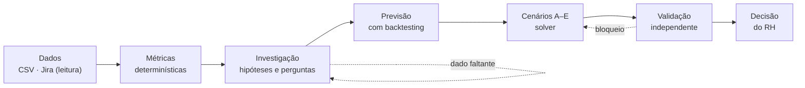
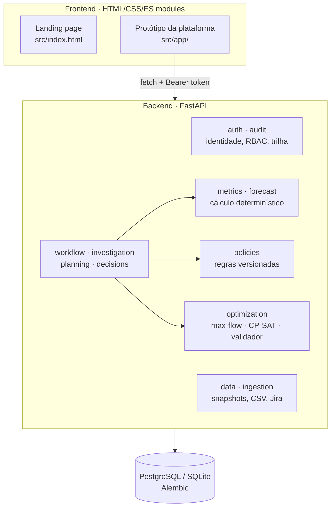

# Alinia — Workforce Intelligence

**Planejamento de capacidade e contratação para RH e operações, com evidências verificáveis e decisão sempre humana.**

A Alinia investiga por que uma equipe não está dando conta da demanda, prevê quanto a demanda deve crescer e monta alternativas para o RH comparar: contratar, contratar temporários, realocar ou capacitar, redesenhar turnos, ou não agir. Cada número aponta para a fonte que o sustenta, cada regra trabalhista tem versão e responsável, e nada é executado sem aprovação de uma pessoa.

> **Estado:** piloto em desenvolvimento. Os dados do repositório são sintéticos ou ilustrativos, e nenhuma integração escreve em sistemas externos. Veja [Estado atual](#estado-atual).

---

## Sumário

- [O problema](#o-problema)
- [A proposta](#a-proposta)
- [Como funciona](#como-funciona)
- [Os cinco cenários](#os-cinco-cenários)
- [Exemplo: Unidade Centro](#exemplo-unidade-centro)
- [O que a Alinia não faz](#o-que-a-alinia-não-faz)
- [Princípios de produto](#princípios-de-produto)
- [Estado atual](#estado-atual)
- [Parte técnica](#parte-técnica)
  - [Arquitetura](#arquitetura)
  - [Stack](#stack)
  - [Como rodar](#como-rodar)
  - [API](#api)
  - [Frontend](#frontend)
  - [Testes e CI](#testes-e-ci)
  - [Estrutura do repositório](#estrutura-do-repositório)
- [Documentação](#documentação)
- [Créditos](#créditos)

---

## O problema

Quando uma equipe de atendimento começa a acumular backlog, a pergunta chega ao RH como "precisamos contratar?". Em geral, a resposta sai de uma planilha que divide a demanda pela produtividade média e devolve um número de pessoas. Essa conta esconde quase tudo o que importa:

- **Demanda não é produção.** Tickets resolvidos não mostram as solicitações que entraram, as que foram canceladas nem as que ficaram sem atendimento.
- **Capacidade não é uma soma de horas.** Ela depende de competência, turno, disponibilidade real, qualidade e retrabalho. A mesma hora não pode ser contada duas vezes.
- **Contratar leva tempo.** Recrutamento, admissão, treinamento, mentoria e ramp-up podem fazer a pessoa chegar depois do pico que justificou a vaga.
- **Existem regras.** Jornada, repousos, modalidade contratual e instrumentos coletivos limitam o que pode ser proposto, e esses limites mudam com o tempo.
- **Existem outras saídas.** Realocar, capacitar, redesenhar turnos ou absorver um pico temporário podem resolver melhor que uma contratação permanente.

## A proposta

A Alinia responde a uma pergunta: **onde, quando, quantas e quais competências adicionais são necessárias para sustentar a demanda, respeitando custos, jornadas, cobertura e direitos?**

Ela não entrega um número solto. Entrega ao RH um dossiê com:

1. **O sinal**: demanda, capacidade e pressão de demanda da equipe, cada valor com a sua fonte.
2. **A investigação**: hipóteses para o descompasso (sazonalidade, cobertura por competência, disponibilidade), marcadas como sustentadas ou não verificadas, e as perguntas que ainda dependem do gestor.
3. **A previsão**: demanda projetada com faixa de incerteza validada por backtesting. Quando o histórico não sustenta uma previsão, a Alinia se abstém em vez de inventar.
4. **Os cenários**: cinco alternativas comparáveis lado a lado, com premissas, custos conhecidos e desconhecidos, prazo de efeito e riscos.
5. **A decisão**: o RH aprova, adia ou rejeita. Aprovar só é possível depois de uma validação independente das restrições rígidas, e mesmo assim o máximo que se gera é um rascunho de requisição, sem nenhum efeito administrativo.

**O diferencial** em relação a um dashboard de déficit é o ciclo de investigação. A Alinia pede o dado que falta, testa hipóteses, chama ferramentas determinísticas de previsão e otimização e explica por que um cenário atende melhor às restrições. Cálculo, regra e validação ficam em código verificável; o modelo de linguagem investiga e explica, mas não decide nem valida.

## Como funciona



1. **Dados auditáveis.** Os dados entram por CSV ou por leitura do Jira, de forma agregada e sem dados pessoais. Colunas como salário, CPF, e-mail ou motivo de afastamento fazem o arquivo ser recusado. Cada importação gera um snapshot imutável.
2. **Métricas.** Capacidade, pressão de demanda (IPD = demanda ÷ capacidade) e gap são calculados por funções determinísticas a partir do snapshot, sem constantes escondidas.
3. **Investigação.** A investigação abre hipóteses, pausa quando precisa de uma resposta do gestor e retoma a partir de um checkpoint salvo no banco. O que o gestor relata fica registrado como relato, não como fato.
4. **Previsão.** Mediana móvel com backtesting. A faixa empírica só aparece quando a cobertura do holdout é validada; com histórico curto ou irregular, a previsão se abstém.
5. **Cenários.** Cinco famílias de cenário, A a E. Uma contratação só é considerada eficaz se a capacidade chega antes do pico.
6. **Validação independente.** Verificadores determinísticos bloqueiam qualquer cenário que fure cobertura obrigatória, habilitação, regra vigente, orçamento ou modalidade (*fail-closed*: na dúvida, bloqueia).
7. **Decisão humana.** O RH decide. Toda ação fica na trilha de auditoria, com as versões das regras e dos dados usados.

## Os cinco cenários

| | Cenário | O que avalia | Principais riscos |
|---|---|---|---|
| **A** | Contratar quadro permanente | Nova capacidade estrutural | Prazo de recrutamento e ramp-up, mentoria, custo |
| **B** | Contratar temporários | Absorver um pico sem aumentar o quadro fixo | Modalidade, prazo legal, qualificação, custo |
| **C** | Realocar ou capacitar | Usar competências complementares de outras equipes | Impacto na equipe de origem, tempo de formação |
| **D** | Redesenhar turnos ou processos | Reorganizar cobertura e fluxo de trabalho | Repousos, cobertura obrigatória por intervalo |
| **E** | Não agir | Custo de manter o quadro atual | Backlog e pressão operacional crescentes |

O cenário E está sempre presente como referência: decidir não agir também tem consequências, e elas precisam ser visíveis.

## Exemplo: Unidade Centro

*Dados ilustrativos, os mesmos usados no protótipo.*

Equipe de atendimento com 11 pessoas, 91% de disponibilidade média e 2,27 atendimentos por hora. A demanda atual é de 1.150 atendimentos por semana, com projeção de 1.200.

| Jornada considerada | Capacidade por semana | Pressão de demanda | Gap para 1.200 |
|---|---|---|---|
| 44h | ~999,8 | 1,15 | 3 posições |
| 42h | ~954,0 | 1,21 | 3 posições |
| 40h | ~908,9 | 1,27 | 4 posições |

A conclusão correta **não** é "contratar três pessoas". É: *na aproximação agregada em 42h faltam três posições, e a composição das vagas depende ainda de cobertura por competência e turno, mentoria, custo e das regras aplicáveis.* É essa ressalva que a Alinia leva ao RH.

## O que a Alinia não faz

- Não seleciona candidatos, não pontua pessoas e não avalia desempenho individual.
- Não recomenda desligamentos.
- Não diagnostica burnout nem infere estado de saúde.
- Não altera salário, contrato, escala ou ponto, e não abre vagas sozinha.
- Não interpreta a lei de forma final: regras jurídicas são entradas versionadas, aprovadas por pessoas.
- Não substitui RH, jurídico, Operações ou profissionais de SST.

Quando faltam dados ou regras, a recomendação específica fica suspensa e o caso vai para revisão.

## Princípios de produto

- **Todo número tem origem.** Métricas, previsões e cenários guardam o snapshot, a versão do modelo e a versão das regras que os produziram.
- **Determinístico antes de LLM.** Cálculo, otimização e validação são código testável. O valor do agente precisa ser demonstrado contra uma solução sem LLM; se não houver ganho, fica a solução determinística.
- **Fail-closed.** Regra ausente, ambígua, revogada ou adulterada bloqueia a conclusão em vez de assumir um padrão.
- **Regras fora do código.** Limites de jornada e afins vivem num Policy Store versionado. Uma regra só entra em vigor com aprovação de alguém diferente de quem a escreveu.
- **Privacidade por fluxo.** Dados agregados, colunas pessoais recusadas na importação, atenção a reidentificação em equipes pequenas e isolamento entre empresas.
- **A decisão é humana.** Aprovar não executa nada. O maior efeito possível é um rascunho de requisição, marcado como não executado.

## Estado atual

O repositório é um **piloto em construção**, alinhado à revisão v4.2 do documento de produto. A matriz completa de requisitos e aceites está em [`docs/REBASELINE_PRD_V42.md`](docs/REBASELINE_PRD_V42.md).

| Peça | Situação |
|---|---|
| Landing page e protótipo navegável | Prontos; o protótipo funciona com dados de exemplo ou ligado à API |
| Identidade, permissões e trilha de auditoria | Implementados (RBAC por empresa e equipe, auditoria só de inclusão); faltam rate limiting e testes de produção |
| Importação CSV e snapshots | Implementados, com recusa de dados pessoais e idempotência |
| Jira | Somente leitura da fixture sintética; a sincronização real depende de credenciais |
| Métricas e previsão | Implementadas (mediana móvel, MAE/WAPE, faixa empírica validada ou abstenção) |
| Policy Store | Implementado, com ciclo rascunho → revisão → aprovado → revogado |
| Cenários A–E e decisão do RH | Implementados no fluxo da API; aprovação travada até haver validação independente |
| Solver no fluxo da API | Max-flow determinístico em horas inteiras |
| Solver OR-Tools CP-SAT e validador v4.2 | Implementados e testados como módulos; **ainda não ligados ao fluxo da API** |
| Agente LLM (LangGraph) | Apenas núcleo de execução simulado; não há agente real no fluxo |

**Bloqueios conhecidos:**
- Nada no fluxo grava ainda o resultado do validador independente, então nenhum cenário pode ser aprovado.
- Não há implantação com dados reais nem requisição automática.
- Faltam as validações de RH, jurídico e privacidade antes do piloto.

---

## Parte técnica

### Arquitetura



O backend é organizado por domínio. Cada um registra seus routers em `backend/app/core/modules.py`. Empresa e equipe sempre vêm do token autenticado, nunca do corpo da requisição nem de texto gerado por modelo.

| Domínio | Pasta | Responsabilidade |
|---|---|---|
| Identidade e auditoria | `app/auth`, `app/audit` | Login, perfis (gestor, RH, admin), permissões por equipe, eventos de auditoria só de inclusão |
| Dados | `app/data`, `app/ingestion` | Snapshots imutáveis, importação CSV, conector Jira somente leitura |
| Cálculo | `app/metrics`, `app/forecast` | Capacidade, IPD e gap; previsão com backtesting e faixa empírica |
| Regras | `app/policies` | Catálogo de regras, versões, aprovação por quatro olhos, resolução por vigência |
| Fluxo | `app/workflow`, `app/investigation`, `app/planning`, `app/decisions` | Investigação com checkpoint, cenários A–E, crítico, decisão e rascunho |
| Otimização | `app/optimization` | Max-flow (em uso), CP-SAT v4.2 e validador independente |
| Contratos | `app/contracts` | Schemas versionados (v1 e v4.2) compartilhados entre domínios |
| Execução | `app/jobs` | Núcleo durável simulado com LangGraph (isolado, sem nós reais) |

### Stack

| Camada | Tecnologia |
|---|---|
| Frontend | HTML, CSS e ES modules nativos, sem framework nem build. Lenis vendorizado para a rolagem da landing |
| Backend | Python 3.12, FastAPI, Pydantic 2, SQLAlchemy 2, Alembic |
| Banco | PostgreSQL 16 (alvo); SQLite para desenvolvimento e testes |
| Otimização | Max-flow próprio; OR-Tools CP-SAT |
| Orquestração | LangGraph (núcleo simulado) |
| Testes e CI | pytest; GitHub Actions |

### Como rodar

Os comandos rodam na raiz do repositório. No Windows, troque `backend/.venv/bin/python` por `backend/.venv/Scripts/python`.

**Só o frontend** (dados de exemplo, sem backend):

```bash
npm run dev       # serve src/ em http://localhost:5173  ·  protótipo em /app/
npm run build     # copia src/ para dist/
npm run preview   # build + serve dist/ em http://localhost:4173
```

O site precisa ser servido por HTTP, porque ES modules e WebGL não funcionam em `file://`.

**Backend e protótipo ligado à API:**

```bash
python3.12 -m venv backend/.venv
backend/.venv/bin/python -m pip install -r backend/requirements.lock.txt

export ALINIA_AUTH_SECRET="<segredo local com 32+ caracteres>"
export DATABASE_URL="sqlite:///./alinia.db"     # ou postgresql+psycopg://...

backend/.venv/bin/python -m alembic -c backend/alembic.ini upgrade head
backend/.venv/bin/python -m backend.app.auth.cli create-tenant --tenant-id empresa-a --name "Empresa A"
backend/.venv/bin/python -m backend.app.auth.cli create-user --tenant-id empresa-a --email rh@empresa-a.example --role rh
backend/.venv/bin/python -m uvicorn backend.app.main:create_app --factory --reload
```

Depois de subir o servidor:

- **Protótipo:** `http://127.0.0.1:8000/prototype/app/index.html`. Use **Conectar dados**, entre com o usuário criado, escolha a equipe e o recorte, e carregue as métricas.
- **Documentação da API:** `http://127.0.0.1:8000/docs`.

A senha do usuário vem de `ALINIA_BOOTSTRAP_PASSWORD` ou do prompt, nunca da linha de comando.

| Variável | Uso |
|---|---|
| `ALINIA_AUTH_SECRET` | Assina os tokens. Obrigatória; sem ela o login responde 503 |
| `DATABASE_URL` | URL SQLAlchemy. Padrão: SQLite local `alinia.db` (ignorado pelo Git) |
| `ALINIA_ACCESS_TOKEN_TTL_SECONDS` | Validade do token (padrão 3600) |
| `ALINIA_BOOTSTRAP_PASSWORD` | Senha usada pela CLI ao criar usuários |
| `JIRA_BASE_URL`, `JIRA_API_TOKEN` | Credenciais do Jira; sem elas a sincronização responde `INTEGRATION_UNAVAILABLE` |

As migrações são explícitas e não rodam na inicialização. O roteiro completo de demonstração (duas empresas, dois RHs, carga do catálogo sintético de regras) está em [`backend/README.md`](backend/README.md).

### API

Todas as rotas abaixo, exceto `/health` e o login, exigem `Authorization: Bearer <token>`.

| Área | Rotas principais |
|---|---|
| Autenticação | `POST /api/auth/login` · `GET /api/auth/me` · `POST /api/auth/logout` |
| Administração | `/api/admin/users`: criar, listar, trocar vínculos, desativar |
| Dados | `GET /api/teams` · `GET /api/teams/{team_id}/snapshots` · `GET /api/teams/{team_id}/metrics?snapshot_id=` |
| Importação | `POST /api/imports` · `POST /api/imports/{id}/confirm` · `POST /api/imports/jira` · `POST /api/imports/jira/sync` |
| Regras | `/api/policies`: criar, versionar, submeter, aprovar, rejeitar, revogar · `GET /api/policies/resolve` |
| Investigação | `POST /api/investigations` · `POST …/{run_id}/advance` · `POST …/{run_id}/answers` · `GET …/{run_id}/forecast` · `GET …/{run_id}/scenarios` · `GET …/{run_id}/audit` |
| Decisão | `POST /api/scenarios/{id}/decisions` · `POST /api/scenarios/{id}/requisition-drafts` |
| Auditoria | `GET /api/audit` |

Erros de negócio devolvem um código estável em `detail.code`:

| Código | Quando acontece |
|---|---|
| `NOT_CONCLUSIVE` | Tentativa de aprovar sem validação independente válida |
| `MATERIAL_CHANGE` | O cenário mudou depois de lido (hash diferente) |
| `POLICY_REVIEW_REQUIRED` | Regra ausente, em conflito ou revogada |
| `FORBIDDEN_SCOPE` | O perfil não tem acesso à equipe |
| `IDEMPOTENCY_CONFLICT` | Repetição com parâmetros diferentes; vale também para uma segunda decisão sobre o mesmo cenário |

### Frontend

**Landing page** (`src/index.html`). Apresenta o produto. É HTML estático com um componente JavaScript por comportamento: o shader WebGL do hero, a moldura metálica, a sequência de chat, os gráficos animados e o FAQ. Todos respeitam `prefers-reduced-motion` e só animam quando estão visíveis. O processo de construção está em [`docs/ABORDAGEM.md`](docs/ABORDAGEM.md).

**Protótipo da plataforma** (`src/app/`). As cinco etapas da jornada de decisão:

| Etapa | Tela | O que mostra |
|---|---|---|
| 1 | Visão geral | Demanda, capacidade, pressão de demanda e déficit, com selo de origem em cada número |
| 2 | Investigação | Pergunta ao gestor, hipóteses com status e fontes que sustentam a análise |
| 3 | Previsão | Demanda projetada, faixa validada ou abstenção, e qualidade do modelo |
| 4 | Cenários | As cinco famílias A–E, com validação independente, e comparação lado a lado |
| 5 | Revisão do RH | Rascunho de requisição, checklist antes de aprovar e decisão |

O protótipo tem dois modos:

- **Dados de exemplo**, o modo padrão: números ilustrativos da Unidade Centro. Nada é enviado ou salvo.
- **Conectado à API**, pelo diálogo **Conectar dados**: login, escolha de equipe e recorte, métricas reais, investigação com perguntas, cenários A–E vindos do backend e registro da decisão. Nesse modo, "Aprovar" fica desabilitado enquanto o cenário não tiver validação independente válida.

### Testes e CI

```bash
backend/.venv/bin/python -m pytest backend/tests -q
```

A suíte cobre:
- contratos, autenticação e auditoria;
- isolamento entre empresas e equipes;
- importação, métricas e previsão;
- Policy Store, fluxo de investigação, cenários e decisões;
- migrações em banco vazio;
- CP-SAT e validador v4.2.

O workflow [`.github/workflows/p1-p2-integration.yml`](.github/workflows/p1-p2-integration.yml) roda a suíte, `pip check`, as migrações num SQLite novo e o build do frontend em pushes para `audit/**` e em PRs para `main`.

### Estrutura do repositório

```
.
├── src/                      # frontend
│   ├── index.html            # landing page
│   ├── app/                  # protótipo da plataforma (index.html, app.css, app.js)
│   ├── styles/               # tokens, base, layout, componentes e seções da landing
│   ├── scripts/              # componentes da landing, libs e Lenis vendorizado
│   └── assets/               # ícones e imagens originais
├── backend/
│   ├── app/                  # domínios FastAPI (ver Arquitetura)
│   ├── migrations/           # revisões Alembic
│   ├── fixtures/             # contratos, regras e Jira sintéticos
│   ├── tests/                # pytest
│   └── README.md             # guia detalhado do backend
├── docs/                     # planejamento, auditorias e rebaseline
├── scripts/                  # build.mjs e serve.mjs (Node puro, sem dependências)
└── dist/                     # saída do build do frontend
```

## Documentação

| Documento | Conteúdo |
|---|---|
| [`backend/README.md`](backend/README.md) | Guia completo do backend: perfis, permissões, Policy Store, fluxo do piloto, roteiro de demonstração, recuperação |
| [`backend/CONTRATOS.md`](backend/CONTRATOS.md) · [`backend/METRICAS.md`](backend/METRICAS.md) | Regras dos contratos compartilhados e do motor de métricas |
| [`docs/REBASELINE_PRD_V42.md`](docs/REBASELINE_PRD_V42.md) | Matriz de requisitos e aceites vigente, com a sequência de correção |
| [`docs/AUDITORIA_P1_P2.md`](docs/AUDITORIA_P1_P2.md) | Auditoria de rastreabilidade anterior (histórica) |
| [`docs/Divisao_IA_Backend_Alinia.md`](docs/Divisao_IA_Backend_Alinia.md) | Divisão do trabalho entre Pessoa 1 (dados, diagnóstico e investigação) e Pessoa 2 (planejamento, cenários e decisão) |
| [`docs/ABORDAGEM.md`](docs/ABORDAGEM.md) | Método de construção da landing page |

## Créditos

- Rolagem suave da landing: [Lenis](https://github.com/darkroomengineering/lenis), licença em `src/scripts/vendor/lenis.LICENSE`.
- Passadas de acabamento visual do protótipo baseadas em [unslop](https://github.com/heydamir/unslop), de Damir Sokolovsky ([@heydamir](https://x.com/heydamir)), CC BY 4.0.
- Imagens e ícones da landing são originais da Alinia; nenhum asset de template de terceiros foi redistribuído.

As regras trabalhistas citadas, incluindo as fixtures sintéticas, são entradas de domínio sujeitas a validação competente. Nada neste repositório constitui parecer jurídico, laudo de SST ou garantia de desempenho preditivo.
