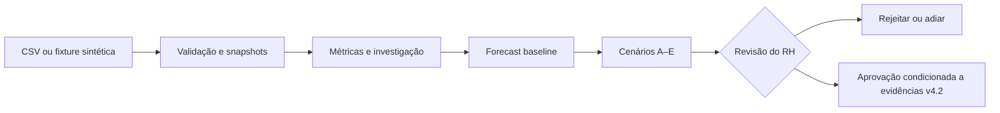

# Alinia — Workforce Intelligence

**Da pressão operacional a decisões de capacidade com evidências.**

A **Alinia** é uma plataforma de apoio ao planejamento de força de trabalho. Ela reúne dados agregados de demanda e capacidade, investiga possíveis causas de desequilíbrio, apresenta previsões e organiza alternativas de ação para avaliação de gestores e RH.

> **Entrega:** protótipo funcional integrado a uma API persistente, demonstrável com dados sintéticos. O produto **não realiza decisões de contratação automaticamente** e ainda possui funcionalidades previstas no PRD v4.2 que não estão completas.

## O problema

Decisões sobre dimensionamento de equipes costumam depender de planilhas, indicadores isolados e percepções sobre o volume de trabalho. Isso cria quatro dificuldades:

- **Demanda ≠ trabalho concluído:** entradas, backlog, reaberturas e demanda não atendida precisam ser diferenciados.
- **Médias escondem gargalos:** capacidade agregada não comprova cobertura da competência correta no turno necessário.
- **Intervenções têm consequências diferentes:** contratar, usar temporários, capacitar, realocar ou reorganizar turnos envolvem prazo, custo, qualificação e restrições distintas.
- **Uma recomendação exige justificativa:** premissas, fontes, incertezas e regras devem ser rastreáveis antes de qualquer decisão administrativa.

A pergunta que orienta a Alinia é: **como identificar a necessidade real de capacidade e comparar respostas possíveis sem transformar dados incompletos em recomendações definitivas?**

## Nossa solução

A plataforma organiza a jornada em cinco etapas:

| Etapa | Valor para o usuário |
| --- | --- |
| **1. Receber** | Importar dados operacionais agregados, validar unidades e manter snapshots por equipe |
| **2. Investigar** | Cruzar demanda e capacidade, registrar hipóteses, evidências, lacunas e perguntas ao gestor |
| **3. Prever** | Projetar demanda com baseline temporal, backtesting e abstenção quando faltarem dados |
| **4. Simular e comparar** | Apresentar alternativas de intervenção e suas dependências e limitações |
| **5. Revisar e decidir** | Submeter os cenários à avaliação do RH, com trilha de auditoria e bloqueios de segurança |

Os **cinco caminhos de decisão** seguem o PRD v4.2: **A** — contratação permanente; **B** — contratação temporária; **C** — realocação ou capacitação; **D** — redesenho de turnos ou processos; **E** — não intervir (*baseline*).

### Experiência entregue

A tela inicial da plataforma é a **conversa com a Alinia**, o agente: a pessoa pergunta em linguagem natural e a Alinia mostra os passos que consultou, o selo de origem de cada número, as perguntas ao gestor e a passagem para a decisão humana. Ao lado da conversa ficam cinco áreas navegáveis: **Visão geral**, **Investigação**, **Previsão**, **Cenários** e **Revisão do RH**. A landing page apresenta o conceito do produto; a plataforma permite autenticação, consulta de recortes persistidos e interação com as APIs de investigação e decisão.

A interface distingue dados ilustrativos de dados recebidos da API. Na revisão, cenários sem validação independente **não podem ser aprovados**. Rejeitar e adiar são decisões registráveis pelo perfil autorizado.

## Visão técnica



| Camada | Stack |
| --- | --- |
| Interface | HTML, CSS, JavaScript ES Modules; gráficos SVG; Lenis na landing |
| API | Python 3.12, FastAPI, Pydantic |
| Persistência | SQLAlchemy, Alembic, SQLite para desenvolvimento; PostgreSQL suportado |
| Planejamento | Solver determinístico de fluxo máximo no workflow atual; OR-Tools CP-SAT v4.2 como módulo separado |
| Investigação | Workflow persistido com checkpoints e retomada; LangGraph experimental separado |
| Qualidade | Pytest, testes de integração, CI para backend/frontend e migrações PostgreSQL |

**Arquitetura atual:** `CSV → snapshot → métricas e investigação → previsão → cenários → revisão humana`. O solver CP-SAT v4.2 e o validador independente já possuem módulos e testes, mas ainda não estão conectados ao fluxo operacional de aprovação.

## Como executar

### Pré-requisitos

**Git** e **Python 3.12** são suficientes para iniciar a plataforma completa com SQLite. **Node.js 22** é necessário somente para executar ou gerar o build do site estático. Todos os comandos a seguir partem da **raiz do repositório**.

### 1. Obter a versão da entrega

```bash
git clone https://github.com/Arturvpf/MangueByte-Converge-challenge.git
cd MangueByte-Converge-challenge
git switch fix/auditoria-v42-p1-p2-2026-11-08
```

Esta versão está no [PR de integração e correções #2](https://github.com/Arturvpf/MangueByte-Converge-challenge/pull/2), ainda separado da `main`.

### 2. Instalar o backend

**Windows — PowerShell**

```powershell
py -3.12 -m venv backend/.venv
.\backend\.venv\Scripts\Activate.ps1
python -m pip install -r backend/requirements.lock.txt
```

**Linux/macOS**

```bash
python3.12 -m venv backend/.venv
source backend/.venv/bin/activate
python -m pip install -r backend/requirements.lock.txt
```

### 3. Configurar autenticação e banco local

O SQLite já é o banco padrão (`sqlite:///./alinia.db`). Defina a chave de autenticação **no mesmo terminal** que executará o backend.

**PowerShell**

```powershell
$env:DATABASE_URL = "sqlite:///./alinia.db"
$env:ALINIA_AUTH_SECRET = python -c "import secrets; print(secrets.token_urlsafe(48))"
```

**Linux/macOS**

```bash
export DATABASE_URL="sqlite:///./alinia.db"
export ALINIA_AUTH_SECRET="$(python -c 'import secrets; print(secrets.token_urlsafe(48))')"
```

O arquivo [`backend/.env.example`](backend/.env.example) descreve as demais variáveis, **mas não é carregado automaticamente**. Não versionar tokens, senhas ou segredos. Para preservar sessões entre reinicializações, reutilize a mesma chave de autenticação.

### 4. Preparar o banco e criar o usuário de demonstração

```bash
python -m alembic -c backend/alembic.ini upgrade head
python -m backend.app.auth.cli create-tenant --tenant-id demo --name "Empresa Demo"
python -m backend.app.auth.cli create-user --tenant-id demo --email rh@demo.example --role rh
```

A criação do usuário solicita uma senha no terminal. O perfil **RH** pode investigar e registrar decisões; o perfil `admin` é destinado à administração de contas e não substitui o RH na demonstração.

Os comandos de criação só precisam ser executados **uma vez em um banco novo**.

### 5. Iniciar a aplicação integrada

```bash
python -m uvicorn backend.app.main:create_app --factory --reload
```

| Endereço local | Finalidade |
| --- | --- |
| [`/prototype/`](http://127.0.0.1:8000/prototype/) | Landing page |
| [`/prototype/app/`](http://127.0.0.1:8000/prototype/app/) | **Plataforma integrada ao backend** |
| [`/docs`](http://127.0.0.1:8000/docs) | Swagger/OpenAPI |
| [`/health`](http://127.0.0.1:8000/health) | Verificação básica do processo |

Todos usam `http://127.0.0.1:8000`. O FastAPI serve os arquivos do frontend e as APIs **na mesma origem**. A aplicação não exige um servidor Node separado para autenticar e consultar dados.

### 6. Carregar dados sintéticos para a demonstração

A plataforma lista snapshots existentes, mas **a importação de CSV ainda não está implementada na interface**. O caminho mais curto para preparar uma demonstração é a fixture de Jira, **sem conexão com Jira real**:

1. Abra [`http://127.0.0.1:8000/docs`](http://127.0.0.1:8000/docs) e execute `POST /api/auth/login` usando `tenant_id: demo`, `email: rh@demo.example` e sua senha.
2. Copie o `access_token` e configure-o no botão **Authorize** do Swagger.
3. Execute `POST /api/imports/jira` com o JSON abaixo. A resposta `status: complete` indica que o snapshot sintético foi persistido.
4. Abra [a plataforma](http://127.0.0.1:8000/prototype/app/), entre com as mesmas credenciais, selecione a equipe `team-demo` e carregue as métricas.

```json
{
  "team_id": "team-demo",
  "fixture": "issues"
}
```

**Alternativa:** usar `POST /api/imports` com um CSV agregado (como texto no campo JSON `content`) e depois `POST /api/imports/{import_id}/confirm`. O formato e os campos obrigatórios estão descritos em [`backend/CONTRATOS.md`](backend/CONTRATOS.md) e em `backend/app/ingestion/csvparse.py`. Nenhum dado pessoal deve ser usado na demonstração.

### 7. Percorrer o fluxo no frontend

Com o snapshot carregado, a demonstração sugerida é: **Visão geral → Abrir investigação → Responder às perguntas → Previsão → Comparar A–E → Revisão do RH**. O mesmo caminho pode ser feito pela **Conversa com a Alinia**, perguntando, por exemplo, "Por que a equipe não dá conta da demanda?" e respondendo às perguntas do gestor ali mesmo.

A investigação pode exigir mais de uma rodada de respostas. Relatos do gestor são preservados como **não verificados**; não alteram automaticamente a capacidade calculada. Para dados históricos insuficientes, a previsão se abstém e os cenários permanecem inconclusivos. A aprovação bloqueada nesses casos é **comportamento esperado**, não uma falha de instalação.

## Testes e build

**Backend e migrações** (ambiente Python ativo):

```bash
python -m pytest backend/tests -q
python -m alembic -c backend/alembic.ini upgrade head
```

**Frontend estático** (Node.js 22):

```bash
node --check src/app/app.js
npm run build
npm run dev
```

`npm run dev` serve apenas os arquivos estáticos em `http://127.0.0.1:5173`. **Para testar a integração com as rotas `/api`, use a plataforma via FastAPI na porta `8000`**, como mostrado acima.

O CI executa testes de backend, regressões da integração HTTP/DOM, verificação de JavaScript, build e migração PostgreSQL a partir de um esquema legado. Veja o [workflow de integração](.github/workflows/p1-p2-integration.yml).

## O que está implementado e o que é evolução

| Componente | Situação da entrega |
| --- | --- |
| Landing e novo frontend conectado à API | **Implementado** |
| Login, papéis, escopo de empresa/equipe e trilha de auditoria | **Implementado para a demonstração** |
| Importação CSV, fixture sintética, snapshots e métricas | **Implementado** |
| Investigação com perguntas, checkpoints e retomada | **Implementado (fluxo determinístico)** |
| Forecast de mediana móvel, backtesting e abstenção | **Implementado como baseline** |
| Cinco categorias de cenário A–E | **Disponíveis**; B/C/D ainda não são simulações quantitativas completas |
| Otimizador CP-SAT v4.2 e validador | **Módulos testados**, ainda não integrados ao workflow principal |
| Agente investigador-planejador com LLM e LangGraph | **Pendente na integração principal** |
| Jira real | **Pendente**: a fixture funciona, mas `/api/imports/jira/sync` não persiste eventos |
| Aprovação operacional definitiva | **Bloqueada por segurança** até validação independente v4.2 |
| Contratação ou alteração de escala automática | **Não implementada nem autorizada** |

Os resultados ilustrativos não são indicadores operacionais reais. Antes de carregar um recorte, o frontend exibe séries de exemplo. Depois, o gráfico da visão geral usa a demanda importada (`demand-flow`), com a capacidade do último período como referência constante; as métricas carregadas da API são identificadas separadamente.

O projeto tem mecanismos de minimização de dados, isolamento por empresa/equipe, histórico de cenários e falha segura nas decisões. **Isso não constitui, por si só, homologação jurídica, de segurança ou LGPD para dados reais.**

## Organização do repositório

```text
src/                      Landing page e aplicação web
scripts/                  Servidor estático e build do frontend
backend/app/              API e módulos de domínio
backend/migrations/       Evolução de esquema com Alembic
backend/fixtures/         Entradas sintéticas para demonstração
backend/tests/            Testes unitários e de integração
docs/                     PRD, auditoria e decisões técnicas
.github/workflows/        Validações automatizadas
```

### Documentação técnica

- [Integração entre frontend e backend](docs/INTEGRACAO_FRONTEND_BACKEND.md)
- [Correções e pendências da auditoria v4.2](docs/CORRECOES_AUDITORIA_V42.md)
- [Matriz de aceite do PRD v4.2](docs/REBASELINE_PRD_V42.md)
- [Backend: autenticação, políticas, contratos e limitações](backend/README.md)
- [Metodologia da landing](docs/ABORDAGEM.md)

---

**Alinia — mais clareza para investigar a necessidade de pessoas, comparar alternativas e decidir com responsabilidade.**

*Versão de entrega demonstrável com dados sintéticos. A evolução para uso operacional depende da integração dos motores v4.2, validação independente e aprovações de domínio.*