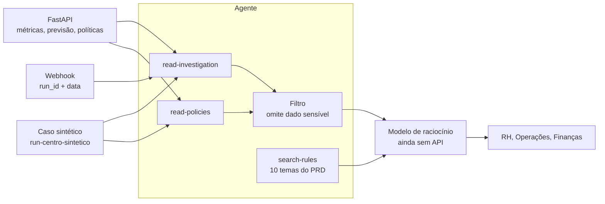

# Alinia Investigator · Workforce Intelligence

**Um agente de leitura que cobre o ciclo do PRD v4.2: recupera a regra, lê o cálculo já feito e devolve um parecer sem dado sensível e sem decidir contratação.**

TypeScript · Agent SDK · LangChain (`RecursiveCharacterTextSplitter`) · índice vetorial local · FastAPI só como fonte, quando houver token

Repositório: [Arturvpf/MangueByte-Converge-challenge](https://github.com/Arturvpf/MangueByte-Converge-challenge) · branch `agent/alinia-investigator`

O caso medido é sintético. Ele reproduz o exemplo homogêneo do PRD (`11 × 42 × 0,91 × 2,27`) e passa pelas ferramentas reais do agente. Não é dado de cliente e não autoriza vaga.

---

## Sobre o projeto

O **Alinia Investigator** é o agente único do piloto de Workforce Intelligence. O backend Python desta mesma branch já calcula capacidade, previsão, cenários e regras. O agente não repete essa conta. Ele explica o que a ferramenta devolveu, cita a regra do PRD e para antes da decisão humana.

### Problema

O PRD v4.2 troca cinco agentes por um, com ferramentas delimitadas. Sem uma barreira na frente do modelo, o piloto falha do mesmo jeito que o documento alerta:

- o modelo inventa headcount, custo ou cobertura quando o campo não veio;
- texto de CSV, Jira ou do gestor entra como instrução e muda o que o agente pode fazer;
- salário, CPF, e-mail e saúde chegam ao contexto;
- um gap agregado vira "contratar três analistas de um cargo";
- a aprovação humana é tratada como um clique, sem premissas nem alternativa descartada.

### Solução

- **Regras recuperadas, não decoradas.** Dez temas do PRD viram documentos, são partidos em trechos de 1000 caracteres com 200 de sobreposição e ficam num índice local. O parecer só afirma regra com o `id` do trecho.
- **Números só da ferramenta.** Capacidade, FTE, IPD, gap e headcount saem do caso já calculado. Campo ausente não vira zero e não vira estimativa.
- **Privacidade antes do modelo.** E-mail, CPF, salário, saúde, sindicato, afastamento, senha e token são omitidos. O valor original não volta mascarado.
- **Entrada tratada como dado.** O webhook aceita só `run_id` e data. Pedido de ignorar instrução ou revelar token é neutro e não escolhe ferramenta.
- **Contratação não conclusiva.** O cenário de contratar 3 pessoas aparece com `conclusive: false`. A política pede revisão. O custo individual não existe, porque o salário foi descartado.
- **Decisão fora do agente.** Aprovar, adiar, rejeitar e redigir requisição continuam nos endpoints do backend, com pessoa autenticada.

---

## O que o PDF cobre e o que foi feito

| Seção do PRD v4.2 | O que o documento pede | O que este agente faz |
| --- | --- | --- |
| 5 e 6 · autonomia e arquitetura | Um agente, ferramentas delimitadas, pessoas decidem | Instruções e skill `investigation-brief`. Sem ferramenta de escrita |
| 7 · fluxo | Hipóteses, pergunta quando falta dado, relato não é fato | O parecer separa fato, hipótese não verificada e relato do gestor |
| 8 e 9 · demanda e capacidade | Demanda separada de entrega; gap homogêneo não escolhe cargo | Tema `capacidade`. O teste usa o exemplo 11 × 42 × 0,91 × 2,27 |
| 10 · previsão | Baseline, intervalo e abstenção se o histórico não basta | Tema `previsao`. O caso sintético volta `abstained` |
| 11 e 12 · cenários | Contratar, capacitar, realocar, redesenhar turnos e não agir | Três cenários no fixture: não agir, realocar e contratar. Nenhum conclusivo |
| 13 · jornada | Guarda de direito, por instrumento coletivo, sem interpretar a lei | Tema `jornada`. Sem regra vigente, o parecer pede revisão |
| 14 · cotas e estágio | Só totais. Estágio não fecha gap estrutural | Tema `cotas` |
| 15 · privacidade | Minimizar antes do modelo. Saúde e sindicato fora | Filtro em `privacy.ts`, aplicado dentro da ferramenta |
| 18 · prova de valor | Três braços: processo atual, cálculo sem modelo, cálculo com modelo | Tema `prova`. Este repositório mede o braço do cálculo. O texto do modelo ainda não entra |
| Decisão do RH | Aprovar, adiar ou rejeitar com justificativa | Fora do agente, de propósito. O backend desta branch já tem o endpoint |

---

## Resultados do teste sintético

O teste sobe o servidor do agente e chama as ferramentas por `callTool`. Fonte: `11 × 42 × 0,91 × 2,27`, demanda projetada 1.200, equipe `team-centro-sintetico`.

| | |
| --- | --- |
| **Checagens** | **17 de 17** passaram |
| **Produtividade** | 420,42 h efetivas · 2,27 atendimentos/hora · 86,7594 atendimentos por pessoa · FTE **10,01** · IPD **1,2574** |
| **Capacidade** | **954,3534** atendimentos no período · **245,6466** sem cobertura |
| **Contratação agregada** | +3 pessoas · 535,08 h efetivas · capacidade **1.214,6316** · cobertura da demanda · folga **14,6316** · **não conclusiva** |
| **Custo** | indisponível: o salário individual foi descartado |
| **Privacidade** | e-mail, CPF, salário e instrução plantada ausentes na saída · run de 1476 para 1454 bytes |
| **Regras** | 10 temas com trecho, em 2 a 7 ms cada |
| **Decisão** | nenhuma aprovação, rejeição ou requisição |

O IPD usa a demanda projetada de 1.200 porque o exemplo do PDF não traz uma demanda atual separada. A contratação agregada mostra o efeito aritmético do gap. Ela não é recomendação: a previsão está abstida, a política pede revisão e a composição por skill e turno continua pendente.

---

## Arquitetura



O modelo não lê arquivo, não vê variável de ambiente e não recebe o corpo cru. `read-investigation` e `read-policies` aplicam o filtro e devolvem `discarded` só com a categoria. O caso `run-centro-sintetico` não chama a rede: ele entra pelo mesmo filtro, para o teste ser reproduzível sem token.

### Superfície

| Chamada | Entrada | O que volta |
| --- | --- | --- |
| `POST /v1/channels/workflow/investigate` | `run_id`, `on_date` | `202`. O parecer sai no turno, quando houver modelo |
| `search-rules` | um tema fixo, não texto livre | até 4 trechos com `id` e fonte |
| `read-investigation` | `runId` no alfabeto seguro | run, previsão e cenários já filtrados |
| `read-policies` | `teamId` e `onDate` | regras vigentes, ou revisão requerida |

Identificador com `../` é recusado. Com `ALINIA_WEBHOOK_TOKEN`, o webhook exige bearer. Sem o token, a rota fica só em loopback.

---

## Decisões de engenharia

**O cálculo fica no backend.** O agente não reimplementa OR-Tools, previsão nem a conta de FTE. O exemplo homogêneo está no fixture para o teste ter os mesmos números do PRD: horas efetivas = pessoas × jornada × disponibilidade; capacidade = horas efetivas × produtividade; pessoas requeridas = teto da demanda projetada dividido pela capacidade de uma pessoa; gap = requeridas − quadro, nunca negativo.

**Uma regra só vale com trecho.** O índice usa o mesmo embedding na gravação e na consulta (`local-hash-v1`). Trocar o modelo de embedding exige `npm run index`. Não há FAISS com pickle: o índice é JSON gerado aqui.

**Dado sensível é omitido, não mascarado.** Um e-mail ou CPF dentro de uma frase some. A frase de "ignore as instruções" e "reveal the token" vira marcação de instrução descartada. O salário individual não entra no custo da contratação.

**O nome `people` é contagem de quadro, não lista de pessoas.** Listas `employees`, `persons` e `trabalhadores` continuam fora. A contagem agregada 11 permanece, porque o PDF precisa dela para o gap.

**O caso sintético tem id próprio.** `run-centro-sintetico` e `team-centro-sintetico` não disputam uma equipe real. Qualquer outro id segue para a API, com `ALINIA_API_BASE` e `ALINIA_API_TOKEN`.

**O modelo é um ponto só.** `bot/lib/reasoning-model.ts` devolve `undefined` até a API existir. Enquanto isso, as ferramentas e o teste rodam sem ela.

---

## Como executar

Na pasta `alinia-investigator`, com Node 22 ou mais novo:

```bash
npm install
npm run index
npm test
npm run impact
```

`npm run impact` sobe o agente, chama as ferramentas com o caso sintético e regrava o relatório em `C:\Users\soninho\Desktop\relatorio-impacto-agente-alinia.txt`.

Para um turno com texto, preencha `bot/lib/reasoning-model.ts` e autentique o Agent SDK. Sem isso, `agent-sdk run` para na credencial.

```bash
npx agent-sdk validate --dir .
npx agent-sdk dev
```

Variáveis, no `.env` local, a partir de `.env.example`:

| Variável | Uso |
| --- | --- |
| `ALINIA_API_BASE` | URL do backend FastAPI |
| `ALINIA_API_TOKEN` | Bearer de leitura. Não entra na resposta |
| `ALINIA_WEBHOOK_TOKEN` | Bearer do webhook. Sem ela, a rota fica em loopback |

---

## Testes

| Comando | O que prova |
| --- | --- |
| `npm test` | e-mail e CPF não voltam; `../` é recusado; os 10 temas devolvem trecho |
| `npm run impact` | 17 checagens do caso do PRD, com tempo, privacidade, produtividade e contratação |
| `npx tsc --noEmit -p .` | os retornos das ferramentas continuam JSON tipado |

O teste de impacto não chama o modelo. Ele mede o que as ferramentas entregam, que é o braço determinístico do PRD.

---

## Estrutura

```
alinia-investigator/
├── bot/
│   ├── agent.ts                         # modelo ainda desligado
│   ├── instructions.md                  # o que o parecer pode afirmar
│   ├── channels/workflow.ts             # webhook run_id + data
│   ├── skills/investigation-brief.md    # ordem das ferramentas e formato
│   ├── tools/
│   │   ├── search-rules.ts
│   │   ├── read-investigation.ts
│   │   └── read-policies.ts
│   └── lib/
│       ├── corpus/                      # regras do PRD e o índice
│       ├── privacy.ts                   # descarte antes do modelo
│       ├── rag.ts
│       ├── synthetic-centro.ts          # exemplo homogêneo
│       └── reasoning-model.ts           # ponto da API do modelo
├── scripts/
│   ├── impact-test.ts                   # teste real com métricas
│   └── demo.ts
└── evals/smoke.eval.ts
```

---

## O que ficou de fora

- A API do modelo de raciocínio. O arquivo existe e devolve `undefined`.
- O texto corrido do parecer. Ele depende dessa API.
- Aprovar, adiar, rejeitar e o rascunho de requisição. O PDF deixa isso com o RH.
- CSV, Jira, solver e previsão ao vivo. Continuam no backend; o agente só lê.
- Deploy. Este diretório não foi publicado em hosting.

Aceite técnico deste teste não substitui aceite de RH, operação ou jurídico para dado real.
